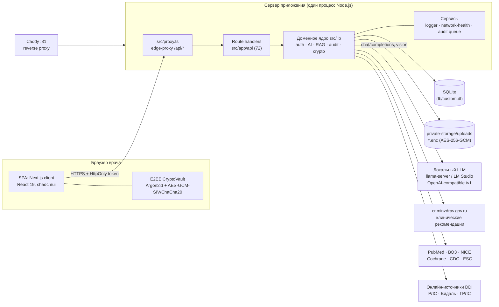
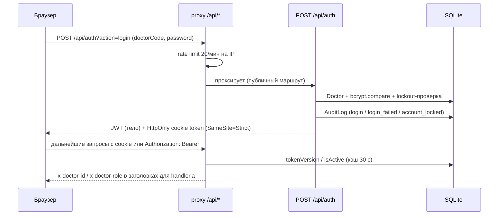
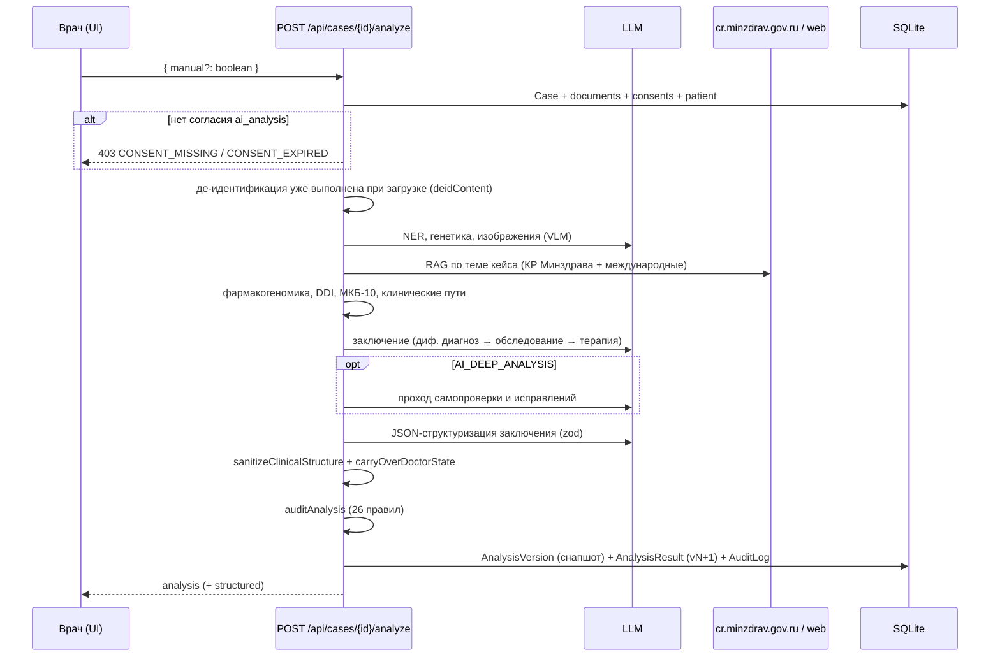
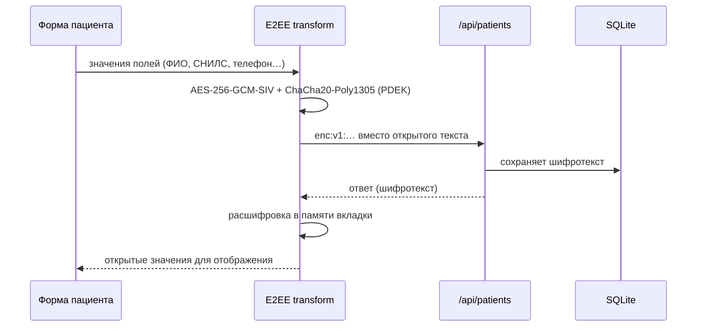

# 01. Архитектура

## 1. Контекст

СППВР — **одноузловое on-premise** приложение для отделения/клиники. Оно не является
SaaS: база, файлы и модель живут на машине заказчика, исходящие запросы — только к
источникам клинических рекомендаций (Минздрав РФ, PubMed/ВОЗ/NICE/Cochrane/CDC/ESC)
и к локальному ИИ-серверу.

## 2. Слои и ответственность

| Слой | Расположение | Ответственность | Правила |
|---|---|---|---|
| **Proxy (edge)** | `src/proxy.ts` | Публичные маршруты, проверка JWT, RBAC-гейт для админских операций, rate limit по IP, скользящее продление сессии | Не содержит бизнес-логики; fail-closed при отсутствии `JWT_SECRET` |
| **API (route handlers)** | `src/app/api/**/route.ts` | Валидация входа zod, проверка доступа, оркестрация домена, HTTP-коды | Только здесь допустимы `NextResponse`; вся запись в БД — через `src/lib` |
| **Домен** | `src/lib/*.ts` | Аутентификация, ИИ-конвейер, RAG, DDI, аудит, крипто, нормализация, проверки | Чистые функции по возможности; серверные модули не импортируются в клиент |
| **Данные** | `prisma/schema.prisma`, `src/lib/db.ts` | Модель, singleton Prisma | JSON-колонки описаны в 03 |
| **Клиент** | `src/app/page.tsx`, `src/components/**` | Одна страница + ленивые «вьюхи», панели, дизайн-система | Сеть — только через `src/lib/api.ts` |
| **Крипто (клиент)** | `src/lib/e2ee/*`, `src/lib/crypto/*` | Ключи, E2EE-поля, контейнеры файлов | Ключи не покидают браузер; сервер видит шифротекст |

## 3. Ключевые потоки

### 3.1 Вход в систему

JWT: HS256, TTL 2 ч, `iss=sppvr-cdss`, `aud=sppvr-cdss-api`, `jti`, `tokenVersion`. Если до
истечения меньше часа — proxy перевыпускает токен (врач не вылетает посреди смены).
Мгновенный отзыв — через `Doctor.tokenVersion` и `isActive`.

### 3.2 Анализ кейса

Полная детализация — [05-ai-pipeline.md](05-ai-pipeline.md).

### 3.3 ЭМК пациента и E2EE

PDEK заворачивается на ключ владельца; выдача доступа другому врачу — через
`PatientAccessGrant` (пере-оборачивание под X25519-ключ получателя). Сервер не видит
ни открытых полей, ни ключей. Детали — [07-security.md](07-security.md).

## 4. Архитектурные решения и компромиссы

| Решение | Причина | Цена |
|---|---|---|
| **SQLite + Prisma** | Нулевая админка, один файл, простой бэкап, on-premise | Один писатель; нет горизонтального масштабирования |
| **JSON в текстовых колонках** (`AnalysisResult.structured`, `sections`, `citations`) | Гибкая эволюция структуры ИИ-вывода без миграций на каждый чих | Нет типизации на уровне БД; валидация — в коде (`zod`, нормализация) |
| **Локальный LLM (OpenAI-compatible)** | ПДн не уходят в облако; работает без интернета | Высокая латентность (минуты на CPU), качество зависит от модели |
| **Двухпроходный ИИ** (черновик + самопроверка + структуризация) | Снижение галлюцинаций и «сырого» текста | 2–3 вызова модели на анализ; время и токены |
| **Детерминированные проверки** (`clinical-audit`, `clinical-normalize`) | Не доверять модели там, где можно посчитать | Дополнительный код и правила, которые надо поддерживать |
| **Терапия за «замком» подтверждения** | Клиническая безопасность: лечение без верификации диагноза недопустимо | Врач обязан выполнить лишний шаг (осознанно) |
| **E2EE карт** | Требование ФЗ-152/HIPAA, zero-knowledge для сервера | Нельзя искать по ФИО на сервере; восстановление ключа невозможно |
| **Hash-chain аудит** | Доказуемая целостность журнала | Запись сериализована (очередь), проверка цепочки — O(n) |
| **Одна страница + lazy views** | Простое развёртывание, быстрый первый рендер | Нет SSR-навигации; состояние в клиенте |

## 5. Границы доверия

| Контур | Что внутри | Доверие |
|---|---|---|
| Браузер врача | Открытые ПДн, DEK/PDEK в памяти, расшифровка | Доверенный (рабочая станция врача) |
| Канал | HTTPS (Caddy), HttpOnly cookie, CSP/HSTS | Требует TLS-терминатора |
| Сервер приложения | Шифротекст ПДн, де-идентифицированные тексты, метаданные | Полу-доверенный: администратор БД видит метаданные |
| LLM | Только `deidContent` и клинический контекст без прямых идентификаторов | Не доверенный источник формулировок; вывод проверяется |
| Внешние источники | Поисковые запросы без PHI (`query-sanitizer`) | Не доверенные; ссылки проверяет врач |

## 6. Ограничения архитектуры

1. **Один процесс.** `proxy.ts` хранит rate limit в `Map`, `audit.ts` — очередь промисов,
   `network-health` — состояние circuit breaker, `lm-studio` — кэш здоровья. Запуск второго
   экземпляра за балансировщиком сломает эти инварианты.
2. **SQLite.** Активная запись блокирует базу; длинные транзакции недопустимы. Анализ
   выполняется вне транзакции, запись — в конце, короткими операциями.
3. **Долгие запросы.** `maxDuration = 600` у анализа; прокси/сервер должны допускать
   ответы до 10 минут (таймауты Caddy по умолчанию это позволяют).
4. **Память.** Локальная модель и Node делят RAM одной машины; при 8K-контексте нужен
   запас ≥ 16 ГБ (зависит от модели).
5. **Обновления Next.js.** `src/proxy.ts` — конвенция Next 16 (бывший `middleware.ts`).
   При откате на Next 15 файл нужно переименовать.

## 7. Куда смотреть дальше

- Установка и `.env` — [02-installation.md](02-installation.md)
- Модель данных — [03-data-model.md](03-data-model.md)
- API — [04-api.md](04-api.md)
- ИИ-конвейер — [05-ai-pipeline.md](05-ai-pipeline.md)
