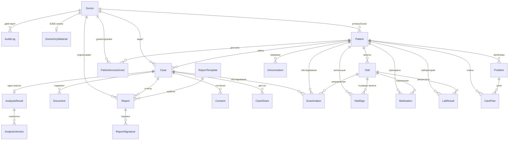

# 03. Модель данных

## 1. Общие принципы

- **СУБД**: SQLite, доступ через Prisma 6 (`prisma/schema.prisma`, `src/lib/db.ts`).
- **Идентификаторы**: `cuid()`.
- **Перечисления**: не Prisma-enum, а `String` с валидацией в коде/zod. Значения перечислены в §5.
- **JSON-агрегаты**: массивы и объекты хранятся в `String`-колонках как JSON (валидируются
  при чтении через `safeJsonParse` / `parseStructured`). Форматы — в §4.
- **Даты**: `DateTime` в БД, ISO-8601 в API.
- **ПДн**: прямые идентификаторы пациента хранятся только в зашифрованном виде (`enc:v1:…`),
  клинические тексты — в де-идентифицированном виде (`Document.deidContent`).

## 2. Карта связей



## 3. Модели по группам

### 3.1 Идентичность и доступ (6)

| Модель | Назначение | Ключевые поля |
|---|---|---|
| `Doctor` | Учётная запись врача/администратора | `doctorCode` (unique), `passwordHash` (bcrypt), `role` (`admin`/`doctor`), `isActive`, `tokenVersion`, `failedLoginAttempts`, `lockedUntil`, `lastLoginAt` |
| `DoctorKeyMaterial` | Публичные части E2EE-ключа врача | `wrappedDek`, `kdfSalt`, `kdfParamsJson`, `checkBlob`, `wrapPubKey`, `wrappedWrapKey` |
| `PatientAccessGrant` | Выдача доступа к карте пациента | `patientId`, `grantorDoctorId`, `granteeDoctorId`, `wrappedPdek`, `grantorWrapPub`, `status`, `expiresAt`, `revokedAt`; unique(`patientId`, `granteeDoctorId`) |
| `CaseShare` | Передача кейса другому врачу | `fromDoctorId`, `toDoctorId`, `accessLevel` (`read`/`comment`), `status` (`active`/`revoked`) |
| `Consent` | Согласия пациента (ФЗ-152) | `consentType`, `granted`, `validUntil`, `notes` |
| `Session`-подобных таблиц нет | JWT stateless + `tokenVersion` | — |

### 3.2 Клинические кейсы и ИИ (4)

| Модель | Назначение | Ключевые поля |
|---|---|---|
| `Case` | Клинический случай | `caseCode` (unique), `status`, `patientToken`, `birthYear`, `sex`, `diagnosisHint`, `icd10Codes` (JSON), `doctorId`, `patientId` |
| `Document` | Загруженный документ | `fileType` (`discharge`/`genetic`/`image`/…), `rawContent`, `deidContent`, `extractedMeta` (JSON), `storagePath`, `mimeType`, `fileSize` |
| `AnalysisResult` | Результат ИИ-анализа (1:1 к Case) | 16 JSON-колонок + `conclusion`, `version`, `caseId` (unique) |
| `AnalysisVersion` | Снапшот предыдущей версии | `analysisId`, `version`, `snapshot` (JSON), `changeNote`, `doctorId`; unique(`analysisId`, `version`) |

### 3.3 ЭМК пациента (9)

| Модель | Назначение | Ключевые поля |
|---|---|---|
| `Patient` | Карта пациента | `patientToken` (unique), E2EE-поля (ФИО, телефон, СНИЛС…), `birthYear`, `sex`, `bloodType`, `height`, `weight`, `smokingStatus`, `alcoholUse`, `allergies` (JSON), `chronicDiseases` (JSON), `familyHistory` (JSON), `status`, `wrappedPdek` |
| `Visit` | Визит (SOAP) | `visitType`, `status`, `chiefComplaint`, `soapSubjective/Objective/Assessment/Plan`, `diagnosis`, `prescriptions`, `scheduledAt`, `durationMin` |
| `VitalSign` | Витальные показатели | АД, ЧСС, ЧДД, температура, SpO₂, рост/вес/ИМТ, глюкоза, сознание, `recordedAt` |
| `Medication` | Препараты | `drugName`, `dosage`, `route`, `frequency`, `duration`, `status`, `indication`, `prescriberId` |
| `LabResult` | Лабораторные результаты | `testName`, `value`, `numericValue`, `unit`, `refRangeLow/High`, `flag`, `collectedAt`, `labName` |
| `Problem` | Проблемы/диагнозы | `title`, `icd10`, `category`, `status`, `severity`, `onsetDate`, `isPrimary` |
| `Immunization` | Прививки | `vaccineName`, `doseNumber`, `administeredAt`, `nextDoseDate`, `reaction` |
| `CarePlan` | Планы ведения | `title`, `type`, `status`, `goals` (JSON), `interventions` (JSON), `problemId` |
| `Examination` | Обследования/направления | `name`, `examType`, `modality`, `status`, `priority`, `orderedAt`, `scheduledAt`, `resultValue`, `resultData` (JSON), `interpretation`, `clinrecCodeVersion` |

### 3.4 База знаний и справочники (6)

| Модель | Назначение |
|---|---|
| `ClinicalRecommendation` | Локальная база КР (seed): `title`, `category`, `gene`, `content`, `keywords`, `source`, `evidenceLevel` |
| `KnowledgeDocument` | Загруженные документы базы знаний: `rawText`, `deidText`, `chunkCount`, `tags`, `isActive` |
| `ICD10Code` | Справочник МКБ-10: `code` (unique), `description`, `chapter`, `block`, `parentCode` |
| `DrugInteraction` | Локальная таблица DDI: `drug1`, `drug2` (unique-пара), `severity`, `mechanism`, `management`, `source` |
| `ClinicalPathway` | Клинические пути: `name`, `icd10Code`, `steps` (JSON), `criteria`, `medications`, `monitoring` |
| `ReportTemplate` | Шаблоны отчётов: `sections` (JSON), `watermark`, `isActive` |

### 3.5 Отчёты, журналы, уведомления, кэши (6)

| Модель | Назначение |
|---|---|
| `Report` | Отчёт: `title`, `content`, `pdfPath`, `status` (`draft`→`approved`→`signed`), `watermark`, `templateId` |
| `ReportSignature` | Электронная подпись: `signatureType` (`approval`/`review`/`cosign`), `comment`, `signedAt` |
| `AuditLog` | WORM-журнал: `action`, `details`, `caseId`, `doctorId`, `ipAddress`, `userAgent`, `prevHash`, `hash` |
| `SystemLog` | Технические логи: `level`, `category`, `message`, `details` |
| `Notification` | Уведомления врача: `type`, `title`, `message`, `caseId`, `isRead` |
| `MinzdravCache`, `DdiOnlineCache` | Кэши внешних источников: `cacheKey` (unique), `payload`, TTL/`expiresAt`, `hitCount` |

## 4. Формат JSON-колонок

### 4.1 `AnalysisResult`

| Колонка | Тип | Формат |
|---|---|---|
| `entities` | `Entity[]` | `{ type: "diagnosis"\|"medication"\|"symptom"\|…, value, context? }` |
| `mutations` | `Mutation[]` | `{ gene, variant, interpretation, clinicalSignificance: "pathogenic"\|"likely_pathogenic"\|"vus"\|"likely_benign"\|"benign" }` |
| `recommendations` | `Recommendation[]` | `{ id?, gene?, title, content, source, relevanceScore, evidenceLevel?, category }` |
| `sections` | `ConclusionSection[]` | `{ title, content, confidence, citations?: string[] \| Citation[] }` |
| `confidence` | `Record<string, number>` | `diagnosis` / `therapy` / `prognosis` / `overall`, 0..1 |
| `citations` | `Citation[]` | `{ claim, source, documentId?, fragment, location? }` |
| `imageFindings` | `ImageFinding[]` | `{ documentId?, description, regionOfInterest?, measurements?, suspicion }` |
| `controlWeights` | `Record<string, number>` | Веса факторов, заданные врачом |
| `doctorComments` | `DoctorComment[]` | `{ id?, author, text, ts }` |
| `therapyRecommendations` | `TherapyRecommendation[]` | Устаревший блок; новый — `structured.therapyOptions` |
| `ddiAlerts` | `DDIAlert[]` | `{ drug1, drug2, severity, description, mechanism, management, … }` |
| `icd10Suggestions` | `ICD10CodeMatch[]` | `{ code, description, confidence, source: "ai"\|"manual" }` |
| `pathwayMatches` | `ClinicalPathwayMatch[]` | `{ name, matchScore, icd10Code?, category, steps? }` |
| `structured` | `AnalysisStructured` | См. §4.2 |

### 4.2 `AnalysisResult.structured` (v5.2)

```jsonc
{
  "differential": [{
    "rank": 1,
    "diagnosis": "Внебольничная пневмония справа, средней степени тяжести",
    "icd10": "J18.9",
    "probability": 0.62,
    "argumentsFor": ["…"],
    "argumentsAgainst": ["…"],
    "workup": ["КТ ОГК"],
    "redFlags": ["SpO2 < 92% — госпитализация"],
    "clinrecCode": "601_2",
    "sources": ["КР Минздрава РФ 601_2"],
    "notes": "чем различить"
  }],
  "workupPlan": [{
    "name": "СРБ, количественно",
    "priority": "urgent",              // urgent | high | routine
    "purpose": "контроль ответа на АБТ",
    "timing": "в течение 1 часа",
    "preparation": "без подготовки",
    "targetDxConfirm": ["Внебольничная пневмония …"],
    "targetDxRefute": ["…"],
    "expectedResult": "СРБ > 100 мг/л",
    "normalRange": "0–5 мг/л",
    "cutoffs": "0–5; серая зона 5–40",
    "confirmsIf": "…", "refutesIf": "…",
    "interpretation": "развёрнутое руководство"
  }],
  "therapyOptions": [{
    "name": "Амоксициллин + клавулановая кислота",
    "regimen": "875/125 мг внутрь 2 раза в сутки 7 дней",
    "evidenceLevel": "A",
    "source": "КР Минздрава РФ 601_2",
    "justification": "механизм и почему этот препарат",
    "targetDx": "Внебольничная пневмония …",   // должен совпадать с гипотезой
    "caution": "противопоказания, контроль до старта"
  }],
  "monitoringPlan": [{ "marker": "СРБ", "frequency": "через 48–72 ч", "target": "↓ ≥ 50%", "purpose": "ответ на АБТ" }],
  "verification": { "performed": true, "passes": 1, "corrections": ["…"], "factsGrounded": true, "verifiedAt": "ISO" },
  "confirmedDx": ["Внебольничная пневмония …"],       // решения врача
  "workupTracker": {                                  // ключ = normalizeWorkupKey(name)
    "срб количественно": { "status": "resulted", "resultValue": "112 мг/л", "resultAt": "ISO", "comment": "…", "updatedBy": "DOC-1", "updatedAt": "ISO" }
  },
  "patientSafety": { "allergies": ["Пенициллины"], "activeMedications": ["…"], "age": 62, "sex": "М", "renal": "Креатинин: 98 мкмоль/л", "capturedAt": "ISO" },
  "normalizationFixes": ["Объединён дубль исследования: …"]
}
```

> `structured` может отсутствовать у старых анализов — клиент и сервер обязаны это допускать.

### 4.3 Прочие JSON-колонки

| Модель.поле | Формат |
|---|---|
| `Case.icd10Codes` | `Array<{ code, description?, confidence?, source? }>` |
| `Document.extractedMeta` | `{ parser, variants?, dimensions?, pages?, warnings? }` |
| `Patient.allergies` | `Array<{ allergen, reaction?, severity?, notedAt? }>` |
| `Patient.chronicDiseases` | `Array<{ name, icd10?, diagnosedAt?, status? }>` |
| `Patient.familyHistory` | `Array<{ relation, condition, notes? }>` |
| `CarePlan.goals` / `interventions` | Массив строк или объектов `{ text, done }` |
| `Examination.resultData` / `attachments` | `{ params: Array<{ name, value, unit, ref }>, files: string[] }` |
| `ClinicalPathway.steps` | `Array<{ order, title, description, … }>` |
| `ReportTemplate.sections` | `Array<{ id, title, type: "text"\|"table"\|"chart"\|"signature", required }>` |
| `AuditLog.details` | Свободный JSON-объект (сериализуется в строку) |

## 5. Статусы и перечисления

| Сущность | Значения | Где задаётся |
|---|---|---|
| `Doctor.role` | `admin`, `doctor` | `createDoctorSchema` |
| `Doctor.isActive` | `true`/`false` | админ-панель |
| `Case.status` | `new`, `uploaded`, `analyzing`, `analyzed`, `reported`, `archived` | `types.ts`, `updateCaseSchema` (без `archived`) |
| `Document.fileType` | `discharge`, `genetic`, `image`, `other` | `parseFileContent` / загрузка |
| `Report.status` | `draft`, `approved`, `signed` | `reports` route, `sign` route |
| `ReportSignature.signatureType` | `approval`, `review`, `cosign` | `signReportSchema` |
| `Consent.consentType` | `data_processing`, `ai_analysis`, `genetic_analysis`, `report_sharing`, `data_retention` | `createConsentSchema` |
| `CaseShare.accessLevel` | `read`, `comment` | `shareCaseSchema` |
| `CaseShare.status` | `active`, `revoked` | маршрут share |
| `PatientAccessGrant.status` | `active`, `revoked` (+ `expiresAt`) | grants route |
| `WorkupStatus` | `planned`, `ordered`, `completed`, `resulted`, `cancelled` | `types.ts`, `controlPanelSchema` |
| `WorkupItem.priority` | `urgent`, `high`, `routine` | `aiStructuredSchema` |
| `Examination.status` | `ordered`, `scheduled`, `in_progress`, `completed`, `cancelled` | examinations route |
| `Examination.priority` | `routine`, `urgent`, `stat` | examinations route |
| `Notification.type` | `analysis_complete`, `report_approved`, `case_shared`, `warning`, `system`, `ddi_alert`, `consent_required` | `types.ts` |
| `Patient.sex` | `М`, `Ж` | `createPatientSchema` |
| `Patient.status` | `active`, `archived`, `deceased` | карта пациента |
| `VitalSign.consciousness` | `clear`, `drowsy`, `stupor`, `coma` (по коду ЭМК) | форма визита |

## 6. Версионирование анализа

1. При повторном анализе текущий `AnalysisResult` целиком копируется в `AnalysisVersion`
   (`snapshot` — JSON всех колонок, включая `structured`).
2. `AnalysisResult.version` инкрементируется, запись перезаписывается новыми данными.
3. `confirmedDx` и `workupTracker` **переносятся** из предыдущей версии, если соответствующие
   диагнозы/исследования остались в новой структуре (`carryOverDoctorState`).
4. История доступна через `GET /api/cases/{id}/analysis/versions` и диалог «История версий».

## 7. Индексы и ограничения

- Уникальные: `Doctor.doctorCode`, `Case.caseCode`, `AnalysisResult.caseId`, `Patient.patientToken`,
  `DoctorKeyMaterial.doctorId`, `ICD10Code.code`, `DdiOnlineCache.cacheKey`, `MinzdravCache.cacheKey`,
  `AnalysisVersion(analysisId, version)`, `DrugInteraction(drug1, drug2)`, `PatientAccessGrant(patientId, granteeDoctorId)`.
- Индексы: по `Case(doctorId, status, createdAt)`, `Document(caseId)`, `Report(caseId, doctorId, status)`,
  `AuditLog(createdAt, doctorId, action)`, `Notification(doctorId, isRead)`, `Patient(primaryDoctorId, status, birthYear)`,
  `Visit(patientId, doctorId, scheduledAt, status)`, `LabResult(patientId, collectedAt, testName)`,
  `Examination(patientId, status, examType, orderedAt, scheduledAt)`, `MinzdravCache(kind, expiresAt)`.

## 8. ПДн и шифрование в модели

- **E2EE-поля** `Patient`: `lastName`, `firstName`, `middleName`, `birthDate`, `phone`, `email`,
  `address`, `snils`, `omiPolicy`, `insuranceNumber`, `nationality`, `occupation`, `notes` —
  хранятся как `enc:v1:…`.
- **Клинические поля** (`sex`, `birthYear`, `bloodType`, аллергии, проблемы, лаборатория)
  хранятся открыто: они псевдонимизированы токеном и нужны для клинических проверок.
- **Документы**: `rawContent` — исходный текст (может содержать PHI, поэтому файл на диске
  зашифрован), `deidContent` — де-идентифицированный текст, который уходит в ИИ.
- **Аудит** не содержит открытых ПДн: только идентификаторы, действия и метаданные.
- Резервное копирование и удаление описаны в [09-operations.md](09-operations.md).
