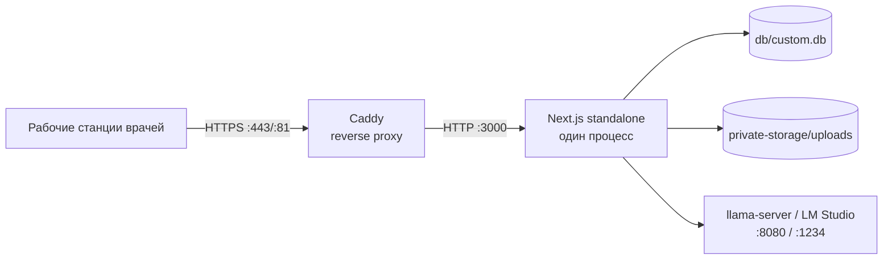

# 09. Эксплуатация

## 1. Топология развёртывания



- Один экземпляр приложения. Второй экземпляр запрещён: сломаются rate limit, очередь аудита,
  кэш здоровья LLM и SQLite-запись.
- Caddy обязателен для TLS и передачи реального IP (`x-real-ip`) — иначе все клиенты попадут
  в один bucket rate limit.
- Модель можно держать на отдельной машине, добавив её хост в `LM_STUDIO_EXTRA_ALLOWED_HOSTS`.

## 2. Запуск и остановка

### Linux (systemd)

```ini
# /etc/systemd/system/sppvr.service
[Unit]
Description=SPPVR CDSS
After=network.target

[Service]
WorkingDirectory=/opt/sppvr
Environment=NODE_ENV=production
ExecStart=/usr/bin/node .next/standalone/server.js
Restart=always
RestartSec=5
User=sppvr

[Install]
WantedBy=multi-user.target
```

```bash
sudo systemctl daemon-reload
sudo systemctl enable --now sppvr
sudo journalctl -u sppvr -f
```

### Windows

Запускайте `node .next/standalone/server.js` через NSSM/Планировщик задач с автозапуском.
Для LLM — отдельная служба `llama-server` с фиксированными `--host 127.0.0.1 --port 8080`.

## 3. Мониторинг

| Что | Как | Тревога |
|---|---|---|
| Приложение и БД | `GET /api/health` (`ok`, `db`) | `ok=false` дольше 2 минут |
| ИИ | `health.ai.ok`, `provider`, `model` | `ai.ok=false` при рабочем процессе врачей |
| Справочники | `health.rag/ddi/icd10` | `false` → не выполнен seed |
| Сеть/источники | `GET /api/network/status` | circuit открыт > 10 минут |
| Ошибки | `SystemLog` (admin → «Администрирование») | всплеск `level=error` |
| Аудит | `GET /api/audit/verify` | расхождение цепочки — критично |
| Диск | `df -h` | < 15% свободно |
| Память | `free -m` / Task Manager | LLM + Node > 90% RAM |

Внешний мониторинг: проверка `/api/health` каждые 60 с, алерт по HTTP ≠ 200 или `ok=false`.
Логи приложения — stdout (journald) + таблица `SystemLog`; файлы `server.log` при запуске
через `npm start`.

## 4. Резервное копирование

### 4.1 Что входит в JSON-бэкап

`GET /api/backup` (admin) возвращает `BackupData`:

```
version, timestamp,
cases, documents, analysisResults, reports,
clinicalRecommendations, drugInteractions, icd10Codes, clinicalPathways,
auditLogs, consents
```

**Не входят**: `Doctor`, `Patient` и вся ЭМК, `ReportTemplate`, `Notification`, а также
**бинарные файлы** документов и PDF. Их нужно бэкапить отдельно.

### 4.2 Полный бэкап (рекомендуется)

```bash
# 1. Остановить приложение (или сделать снапшот ФС)
sudo systemctl stop sppvr

# 2. Скопировать БД и файлы
cp db/custom.db /backup/custom-$(date +%F).db
tar czf /backup/private-storage-$(date +%F).tar.gz private-storage/

# 3. (опционально) JSON-бэкап для переноса кейсов
curl -b cookies.txt http://localhost:3000/api/backup > /backup/cases-$(date +%F).json

sudo systemctl start sppvr
```

- Бэкап содержит шифротекст ПДн и метаданные — храните с тем же уровнем доступа, что и БД.
- Проверяйте восстановление на стенде не реже раза в квартал.
- `POST /api/backup` восстанавливает таблицы из JSON (каждая — в транзакции); это **не**
  полное восстановление системы, а импорт кейсов/справочников.

## 5. Ротация ключей

### 5.1 JWT_SECRET

1. Сгенерировать новый: `openssl rand -hex 32`.
2. Заменить в `.env`, перезапустить приложение.
3. Все сессии инвалидируются — врачи входят заново.

### 5.2 ENCRYPTION_KEY (файлы)

```bash
# 1. Заменить ENCRYPTION_KEY в .env на новый
# 2. Перешифровать файлы старым ключом (dry-run сначала)
bun scripts/rotate-encryption-key.ts <OLD_PASSPHRASE> --dry-run
bun scripts/rotate-encryption-key.ts <OLD_PASSPHRASE>
```

Скрипт расшифровывает каждый `*.enc`, шифрует новым ключом, проверяет round-trip и только
затем заменяет файл. Ошибка расшифровки оставляет файл нетронутым и попадает в отчёт.

### 5.3 E2EE

Ключи врача привязаны к его парольной фразе. При компрометации — смена пароля и
пере-выпуск key material (старые PDEK пере-оборачиваются). Карты, зашифрованные старым
PDEK, остаются читаемыми, пока жив старый ключ; процедура требует участия владельца карты.

## 6. Обслуживание LLM

| Параметр | Что делать |
|---|---|
| Модель не грузится | проверить RAM/VRAM, путь к GGUF, `-ngl` |
| Медленно (> 10 мин) | уменьшить контекст, `INTL_RAG_MAX_RESULTS`, отключить self-verify |
| Обрывы ответа | поднять `LM_STUDIO_TIMEOUT_MS`, `LM_STUDIO_IDLE_TIMEOUT_MS`, `AI_MAX_TOKENS_ANALYSIS` |
| Пустые ответы | проверить `health.ai.model`, логи `ai`; перезапустить сервер |
| Смена модели | изменить `*_MODEL`, перезапустить; первый запрос прогреет модель |
| Память | держать один процесс LLM; не запускать LM Studio и llama-server одновременно |

## 7. Обновление версии

См. [02-installation.md](02-installation.md) §8. Порядок: бэкап → код → зависимости →
миграции → сборка → рестарт → smoke-тест (§5 в 08-testing.md).

## 8. Runbook инцидентов

### 8.1 Подозрение на компрометацию `.env`

1. Немедленно заменить `JWT_SECRET` и `ENCRYPTION_KEY` (новые ≥ 64 символов).
2. Перезапустить приложение (сессии инвалидированы).
3. Перешифровать файлы `rotate-encryption-key.ts`.
4. Проверить `AuditLog` на аномальные входы/действия, `GET /api/audit/verify`.
5. Уведомить ответственного за ПДн; при утечке ПДн — процедура по ФЗ-152 (72 часа).

### 8.2 Забыт пароль администратора

- Штатного «сброса по email» нет (on-premise).
- Если администраторов несколько — второй админ меняет пароль через админ-панель.
- Если админ один: создать нового администратора через Prisma-скрипт на сервере
  (`bcrypt.hash` + `db.doctor.update`), затем сменить пароль штатно. Операция выполняется
  разработчиком/администратором БД и фиксируется в тикете.

### 8.3 `database is locked`

1. Убедиться, что запущен ровно один экземпляр приложения.
2. Проверить долгие операции (анализ пишет в конце, но миграции/бэкап могут держать запись).
3. Перезапустить приложение; при повторе — проверить диск и права на `db/`.

### 8.4 Цепочка аудита нарушена

1. Не удалять и не «чинить» записи вручную.
2. Зафиксировать вывод `GET /api/audit/verify` (номер записи, ожидаемый/фактический hash).
3. Сделать копию БД для расследования.
4. Восстановить из последнего валидного бэкапа, если повреждение критично; инцидент оформить.

### 8.5 LLM завис / анализ не завершается

1. Проверить `GET /api/health` → `ai.error`.
2. Перезапустить LLM-сервер; при необходимости — приложение.
3. Кейс не «залипает»: внешний catch возвращает статус `uploaded`, можно повторить анализ.
4. Временно снизить нагрузку: `AI_SELF_VERIFY_PASSES=0`, `INTL_RAG_ENABLED=false`.

### 8.6 Диск заполнен

`private-storage` растёт от документов и PDF. Очистка — только через удаление кейсов/отчётов
в приложении (с аудитом). Не удаляйте `*.enc` вручную: метаданные в БД станут
несогласованными.

## 9. Ёмкость и производительность

| Ресурс | Оценка |
|---|---|
| SQLite | до сотен тысяч записей без деградации при одном писателе |
| Документы | 25 МБ × число документов; следите за диском |
| Анализ | 1–3 вызова LLM × (30 с … 8 мин) в зависимости от железа |
| Параллелизм | 1–2 одновременных анализа; больше — очередь на стороне LLM |
| Браузер | E2EE Argon2id 1–3 с при разблокировке |

## 10. Регламент сопровождения

| Периодичность | Действие |
|---|---|
| Ежедневно | `/api/health`, просмотр ошибок `SystemLog` |
| Еженедельно | `audit/verify`, проверка свободного места, бэкап |
| Ежемесячно | проверка восстановления бэкапа на стенде, обновление модели/зависимостей |
| Ежеквартально | пересмотр доступов, ротация секретов (по политике), проверка чек-листа безопасности |
| При инциденте | runbook §8 + запись в журнал инцидентов |
